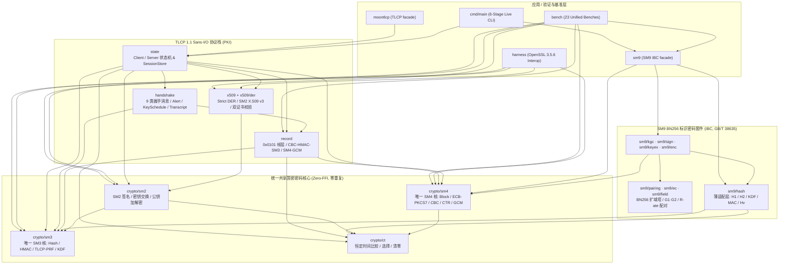

# MoonTLCP 统一国密安全架构与规范说明

> 模块名：`CoolrfulDARkness/moontlcp`  
> 目标标准：GM/T 0024-2014 / GB/T 38636-2020（TLCP 1.1）、**GB/T 38635-2020 / GM/T 0044-2016（SM9 Part 1–5）**、GM/T 0015-2023、GB/T 32905-2016（SM3）、GB/T 32907-2016（SM4）、GB/T 32918-2016（SM2）、RFC 8998（SM4-GCM）  
> 核心定位：**纯 MoonBit、零 FFI、类型安全的国密全栈安全基础设施**——将 **TLCP 1.1 双证书 PKI 传输层协议** 与 **SM9 BN256 标识密码（IBC）完整套件** 统一构建在同一套零重复的 `crypto/{ct,sm3,sm4}` 密码核心之上，零修改编译运行于 `wasm` / `js` / `native` 三端。

---

## 1. 统一分层架构与共享原语去重拓扑

`moontlcp` 采用严格自底向上的单向无环（DAG）分层设计。**全仓仅存在一份 SM3 压缩实现（`crypto/sm3`）、一份 SM4 S-box 与轮密钥实现（`crypto/sm4`）和一份恒定时间底层原语（`crypto/ct`）**：TLCP 协议栈与 SM9 标识密码套件共同复用该统一底层，杜绝密码原语多份拷贝与安全补丁漂移。

### 1.1 共享原语去重边界

| 共享原语包 | 唯一实现职责 | TLCP 复用点 | SM9 复用点 |
| :--- | :--- | :--- | :--- |
| `crypto/ct` | `ct_eq`、`ct_eq_view`、`ct_is_zero_u32`、`ct_eq_u32`、`ct_lt_u32`、`ct_select_u32`、`ct_select_byte`、`zeroize` | `crypto/sm2`、`crypto/sm4`、`record`、`state` | `sm9/hash::ct_eq_bytes` 直接委托 `@ct.ct_eq_view`；`sm9/enc` 与 `sm9/keyex` 常量时间验证 |
| `crypto/sm3` | 唯一 SM3 压缩与流式引擎（`Sm3::new`/`reset`/`clone`/`update`/`update_view`/`update_byte`/`finalize`） | `crypto/sm2`、`record`、`handshake`、`state` | `sm9/hash::Sm3` 薄包装直接委托 `@core_sm3.Sm3`，零重复压缩逻辑 |
| `crypto/sm4` | 唯一 SM4 S-box 与 32 轮密钥核（`ecb_encrypt_pkcs7`/`ecb_decrypt_pkcs7`、`cbc_*`、`ctr_crypt`、`gcm_*`） | `record`（CBC/GCM）、`state`、`harness` | `sm9/enc`（GB/T 38635.4 A.3 `Sm4EcbPkcs7`）与 `sm9` 门面直接调用 `@sm4.Sm4Key::new` + `ecb_*_pkcs7` |

### 1.2 全仓包职责与 `.mbti` 公共接口边界

每个子包均通过 `moon info` 生成 `pkg.generated.mbti` 固化对外 API 契约，CI 通过 `git diff --exit-code -- '*.mbti'` 防止意外破坏公共接口：

| 包路径 | 内部依赖 | 核心公开类型与函数（见各自 `pkg.generated.mbti`） | 封装边界 |
| :--- | :--- | :--- | :--- |
| `crypto/ct` | 无 | `ct_eq`、`ct_eq_view`、`ct_is_zero_u32`、`ct_eq_u32`、`ct_lt_u32`、`ct_select_u32`、`ct_select_byte`、`zeroize` | 零依赖，供全库恒定时间原语复用 |
| `crypto/sm3` | 无 | `Sm3`（`new`/`reset`/`update`/`update_view`/`update_byte`/`clone`/`finalize`）、`sm3`、`sm3_view`、`hmac_sm3`、`hmac_sm3_parts`、`tlcp_prf`、`kdf_sm3` | 流式 `clone()` 支撑 Transcript 与 SM9 `Hv`/`KDF` 无损复用 |
| `crypto/sm4` | `crypto/ct` | `Sm4Key`（`new`/`encrypt_block`/`decrypt_block`/`ecb_encrypt_pkcs7`/`ecb_decrypt_pkcs7`/`cbc_*`/`ctr_crypt`/`gcm_encrypt`/`gcm_decrypt`）、`Sm4Error` | 原始轮密钥隐藏于 `Sm4Key`，PKCS#7 与 GCM 鉴权全路径恒定时间 |
| `crypto/sm2` | `crypto/ct`, `crypto/sm3` | `PrivateKey`、`PublicKey`、`KeyExchangeResult`、`Sm2Error`、`DEFAULT_SM2_ID`、`compute_za`、`sign_*`/`verify_*`、`key_exchange_*`、`encrypt_*`/`decrypt_*` | 内部大整数与点坐标私有，构造入口强制曲线与范围校验 |
| `sm9/hash` | `crypto/ct`, `crypto/sm3` | `Sm3`、`hash`、`hash_hex`、`kdf`、`mac`、`hv_bytes`、`h1_hash40`、`h2_hash40`、`h1`、`h2`、`ct_eq_bytes`、`bytes_to_hex`、`hex_to_bytes` | 纯 SM9 辅助函数薄适配层，零重复 SM3 压缩实现 |
| `sm9/field` | 无 | `U256`、`Fp`、`Fn`、`Fp2`、`Fp6`、`Fp12`、`modulus_p`、`order_n`、`ct_mask` | BN256 256-bit Montgomery 算术与 12 次扩域塔 |
| `sm9/ec` | `sm9/field` | `G1Affine`、`G1Jac`、`G2Affine`、`G2Jac`（恒定时间标量乘、严格编解码与 `is_in_subgroup`） | 入口严格拦截无穷远、超界、非曲线、wrong-twist 与 G2 cofactor 点 |
| `sm9/pairing` | `sm9/field` | `pair_coords`、`pair_product_coords` | 最优 R-ate Miller 循环与共享最终幂运算 |
| `sm9/kgc` | `sm9/{hash,field,ec,pairing}` | `HID_SIGN`/`HID_KEYEX`/`HID_ENC`、`SignMasterPrivateKey`/`SignMasterPublicKey`/`SignUserPrivateKey`、`EncMasterPrivateKey`/`EncMasterPublicKey`/`EncUserPrivateKey`、`extract_*` | KGC 主密钥派生、用户私钥提取与配对不变量校验 |
| `sm9/sign` | `sm9/{hash,field,ec,pairing}` | `Signature`、`sign_with_r`、`sign_deterministic`、`verify` | GB/T 38635.2 签名/验签，严格拒绝 `h=0`、`h>=N` 及畸形 `S` |
| `sm9/keyex` | `sm9/{hash,field,ec,pairing}` | `ResponderResult`、`InitiatorResult`、`generate_ephemeral`、`responder_exchange`、`initiator_exchange`、`verify_responder_confirmation` | GB/T 38635.3 密钥交换与常量时间 `S_B`/`S_1`、`S_A`/`S_2` 双向确认 |
| `sm9/enc` | `sm9/{hash,field,ec,pairing}`, `crypto/sm4` | `MIN_ENTROPY_LEN`、`MAX_KDF_LEN`、`EncMode`（`KdfXor`/`Sm4EcbPkcs7`）、`KemOutput`、`kem_*`、`encrypt_*`、`decrypt` | GB/T 38635.4 KEM & PKE，统一失败返回 `Err("decryption failed")` 防 IND-CCA2/padding oracle |
| `sm9` | `sm9/*`, `crypto/sm4` | SM9 统一高层门面（`pair`/`pair_product`/`sign_*`/`extract_*`/`sign`/`verify`/`keyex_*`/`kem_*`/`encrypt`/`decrypt`/`sm4_*_ecb_pkcs7`） | 一站式 SM9 标识密码调用入口 |
| `x509/der` | 无 | `DerError`、13 项 `TAG_*`、12 项 `OID_*`、`DerReader`、`DerWriter`、`PemBlock`、`pem_encode`/`pem_decode_all` | 零依赖 Strict DER 编解码器 |
| `x509` | `x509/der`, `crypto/sm2` | `X509Error`、`KeyUsage`、`Certificate`、`DualCertBundle`、`parse_and_verify_dual_certs`、`CertSpec`、`build_sm2_cert`、`TestPki`、`generate_test_pki` | 基于原始 `tbs_der` 验签，强制双证书用途分离与链式信任根验证 |
| `record` | `crypto/ct`, `crypto/sm3`, `crypto/sm4` | `TLCP_VERSION_*`（`0x0101`）、`ContentType`、`RawRecord`、`RecordError`、`CipherState`、`RecordLayer` | 仅验证通过后自增 64-bit `seq`，抗 Lucky13 与版本降级 |
| `handshake` | `crypto/sm3`, `record` | `AlertLevel`、`AlertDescription`（18 项）、`CipherSuite`（4 套件）、`HandshakeMsg`（9 类消息）、`KeyBlock`、`Transcript` | 纯编解码与密钥派生，不含状态迁移逻辑 |
| `state` | `crypto/*`, `record`, `handshake`, `x509` | `ClientConfig`、`ServerConfig`、`SessionStore`、`ResumedSession`、`Event`、`StateError`、`ClientConn`、`ServerConn` | 统一驱动握手、双证校验、加密通道、会话复用与 Fail-Closed 告警 |

---

## 2. 国标条款覆盖矩阵（TLCP 1.1 + SM9）

### 2.1 GM/T 0024-2014 / GB/T 38636-2020（TLCP 1.1）

| 规范条目 | 标准条款 | 本项目实现位置 | 关键约束与行为 |
| :--- | :--- | :--- | :--- |
| **协议版本 `0x0101`** | GM/T 0024 §6.2.1 / GB/T 38636 §6.2.1 | `record/record.mbt`, `handshake/messages.mbt` | 固定 `TLCP_VERSION_MAJOR = 0x01`、`TLCP_VERSION_MINOR = 0x01`；显式拒绝 TLS 1.2 (`0x0303`) 或降级版本 (`0x0100`) |
| **四大强制密码套件** | GM/T 0024 §6.4.1 / RFC 8998 | `handshake/cipher_suite.mbt` | 完整实现 `ECDHE_SM4_CBC_SM3` (`0xE011`)、`ECC_SM4_CBC_SM3` (`0xE013`)、`ECDHE_SM4_GCM_SM3` (`0xE051`)、`ECC_SM4_GCM_SM3` (`0xE053`) |
| **记录层分片与防 Lucky13** | GM/T 0024 §6.2.1 / §6.2.3.2 | `record/record.mbt`, `crypto/sm4`, `crypto/sm3` | `MAX_PLAINTEXT_LEN = 16384`、`MAX_CIPHERTEXT_LEN = 18432`；CBC 解密恒定时间填充检查 + 固定窗口 MAC 提取 + SM3 压缩块对齐；GCM 采用 RFC 5288 严格 `seq_num` 显式 Nonce |
| **双证书链与用途分离** | GM/T 0024 §6.4.5.2 | `x509/dual_cert.mbt`, `x509/cert.mbt` | `certificates[0]` 为签名证书、`certificates[1]` 为加密证书；互换立即抛 `DualCertMismatch`；禁止 CA 证书冒充终端双证；空 `trust_anchors` Fail-Closed |
| **ECC/ECDHE 密钥交换与 mTLCP** | GB/T 38636 §6.4.5.4–6.4.5.8 | `handshake/messages.mbt`, `crypto/sm2`, `state/` | 静态 ECC 强制 `ServerKeyExchange` 签名绑定加密证书；ECDHE 基于 SM2-KE 派生 48B PMS；完整支持 `CertificateRequest`/`CertificateVerify` mTLCP 互验 |
| **PRF_SM3、Alert 与会话复用** | GM/T 0024 §6.2.2 / §6.3 / §6.4 | `crypto/sm3`, `handshake/`, `state/session.mbt` | 18 项标准 Alert 代码；`SessionStore` 简短握手复用（实测节省 77% 字节），并对 mTLCP 策略严格隔离 |

### 2.2 GB/T 38635-2020 / GM/T 0044-2016（SM9 标识密码算法）

| 规范条目 | 标准条款 | 本项目实现位置 | 关键约束与行为 |
| :--- | :--- | :--- | :--- |
| **BN256 曲线与扩域塔** | GB/T 38635.1 / Part 5 | `sm9/field/`, `sm9/ec/` | 完整 `Fp → Fp2 → Fp6 → Fp12` 扩域塔、`G1`（$y^2=x^3+5$）与 `G2`（$y^2=x^3+5u$）恒定时间标量乘，G2 严格素数阶子群检验 |
| **辅助函数 `H1`/`H2`/`KDF`/`MAC`** | GB/T 38635.1 §5.4.2–5.4.5 | `sm9/hash/hash.mbt` → `crypto/sm3` & `crypto/ct` | 40 字节 `Hv` 展开 + 恒定时间 320-bit 精确约简 `(Ha mod (N-1)) + 1`；零重复 SM3 压缩核 |
| **最优 R-ate 双线性对** | GB/T 38635.1 §5.3 | `sm9/pairing/pairing.mbt` | Miller 循环 + 最终幂 + 双配对共享最终幂 `pair_product_coords`；`e(P2, P1)` 384B 与国标逐字节一致 |
| **KGC 主密钥与用户私钥提取** | GB/T 38635.2/3/4 §6 | `sm9/kgc/kgc.mbt` | `HID_SIGN = 0x01`、`HID_KEYEX = 0x02`、`HID_ENC = 0x03`；支持种子派生与严格字节解析 |
| **SM9 数字签名算法** | GB/T 38635.2 Appendix A | `sm9/sign/sign.mbt` | 确定性域分离 nonce 与指定 `r` 双接口；96B/97B 严格编解码，拒绝 `h=0`/`h>=N`/畸形 `S` |
| **SM9 密钥交换协议** | GB/T 38635.3 Appendix A | `sm9/keyex/keyex.mbt` | `R_A`/`R_B` 临时点、三配对共享值 `(g1,g2,g3)`、KDF 派生与常量时间 `S_B==S_1`、`S_A==S_2` 双向确认 |
| **SM9 KEM 与公钥加密** | GB/T 38635.4 Appendix A.1–A.3 | `sm9/enc/enc.mbt` → `crypto/sm4` | KEM、`KdfXor` 流加密、`Sm4EcbPkcs7`（直接复用共享 `crypto/sm4`）；强制 ≥32B CSPRNG 熵与 `MAX_KDF_LEN = 16 MiB` 上限；恒定时间 MAC/非零 `K1`/填充校验统一返回 `Err("decryption failed")` |

### 2.3 明确不在本期范围内的非目标项（Scope Boundaries）

1. **DTLCP（基于 UDP 的数据报传输层国密协议）**：聚焦流式 TLCP 1.1。
2. **操作系统 Socket / 网络 I/O / 异步运行时绑定**：刻意保持纯 Sans-I/O 零 FFI 核心，适配浏览器 Wasm、Node/Edge JS 与原生服务端。
3. **硬件密码设备驱动（PKCS#11 / SKF / SDF）**：纯 MoonBit 软件密码实现。
4. **在线吊销检查（CRL / OCSP）与 OS 时钟读取**：完整暴露证书有效期字段，由宿主应用结合自身时钟源校验。
5. **会话重协商（Renegotiation）与 ZUC 套件**：规避重协商攻击面，聚焦 4 大主流 SM4+SM3 套件。
6. **OS CSPRNG 直接 FFI 调用**：全部随机性由调用方通过 `seed` / `entropy`（SM9 强制 ≥32B）注入；生产部署须注入操作系统 CSPRNG 高熵种子。

---

## 3. 安全与恒定时间防御设计

1. **恒定时间底层原语（`crypto/ct`）**：所有敏感比较、选择、掩码与清零均走无分支位运算，TLCP 与 SM9 统一复用。
2. **SM2 & SM9 恒定时间椭圆曲线防御**：SM2 采用 4-bit 固定窗口恒定时间标量乘 + RFC 6979 确定性签名；SM9 对 `G1`/`G2` 标量乘、320-bit `H1`/`H2` 模约简及 `G2` 子群检验（`is_in_subgroup`）全路径防御 wrong-twist 与 cofactor 攻击。
3. **Record 层抗 Lucky13 与 SM9 抗 IND-CCA2 / Padding Oracle**：TLCP CBC 解密执行恒定时间填充检查 + 固定窗口 MAC 提取 + SM3 压缩块差值对齐；SM9 `decrypt` 与 `crypto/sm4::ecb_decrypt_pkcs7` 执行恒定时间 `C3` MAC、非零 `K1` 及 PKCS#7 校验，统一错误出口杜绝侧信道区分。
4. **Strict DER & Fail-Closed 状态机**：严格按 ITU-T X.690 唯一 DER 解码，基于原始 `tbs_der` 验签；TLCP 任何非法状态跳转、版本降级或标签篡改均立即下发 Fatal Alert 并永久锁死 `Failed` 态。
