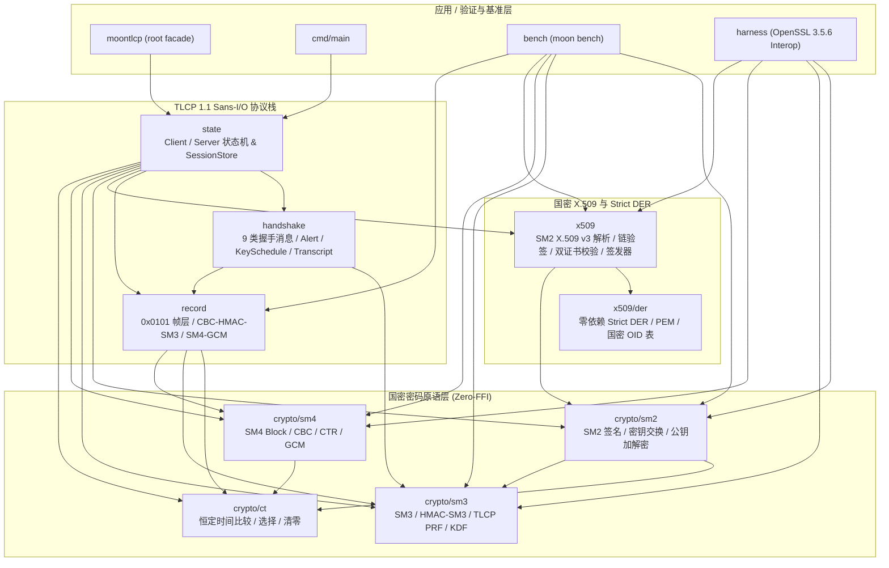

# MoonTLCP 架构设计与安全规范说明

> 模块名：`CoolrfulDARkness/moontlcp`  
> 目标标准：GM/T 0024-2014 / GB/T 38636-2020（TLCP 1.1）、GM/T 0015-2023、GB/T 32905-2016（SM3）、GB/T 32907-2016（SM4）、GB/T 32918-2016（SM2）、RFC 8998（SM4-GCM）  
> 核心定位：**纯 MoonBit、零 FFI、类型安全、Sans-I/O** 的国密双证书传输层密码协议栈，同一套代码零修改编译运行于 `wasm` / `js` / `native` 三端。

---

## 1. 分层架构与包依赖拓扑

`moontlcp` 采用严格自底向上的单向无环（DAG）分层设计，所有底层密码原语与 ASN.1 编解码器均不依赖任何操作系统 I/O 或外部 C/FFI 库；协议层采用 Sans-I/O 字节流喂入/吐出模型，彻底隔离网络传输与密码状态机。

### 1.1 包职责与 `.mbti` 公共接口边界

每个子包均通过 `moon info` 生成 `pkg.generated.mbti` 固化对外 API 契约，CI 通过 `git diff --exit-code -- '*.mbti'` 防止意外破坏公共接口：

| 包路径 | 内部依赖 | 核心公开类型与函数（见各自 `pkg.generated.mbti`） | 封装边界 |
| :--- | :--- | :--- | :--- |
| `crypto/ct` | 无 | `ct_eq`、`ct_eq_view`、`ct_is_zero_u32`、`ct_eq_u32`、`ct_lt_u32`、`ct_select_u32`、`ct_select_byte`、`zeroize` | 零依赖，供全库恒定时间原语复用 |
| `crypto/sm3` | 无 | `Sm3`（`new`/`update`/`update_view`/`clone`/`finalize`）、`sm3`、`sm3_view`、`hmac_sm3`、`hmac_sm3_parts`、`tlcp_prf`、`kdf_sm3` | 流式 `clone()` 支撑不破坏 Transcript 状态的中间摘要计算 |
| `crypto/sm4` | `crypto/ct` | `Sm4Key`（`new`/`encrypt_block`/`decrypt_block`/`cbc_*`/`ctr_crypt`/`gcm_encrypt`/`gcm_decrypt`）、`Sm4Error` | 原始轮密钥隐藏于 `Sm4Key`，GCM 鉴权恒定时间比较 Tag |
| `crypto/sm2` | `crypto/ct`, `crypto/sm3` | `PrivateKey`、`PublicKey`、`KeyExchangeResult`、`Sm2Error`、`DEFAULT_SM2_ID`、`compute_za`、`sign_with_k`/`sign_deterministic`/`sign_der`、`verify_raw`/`verify_der`、`key_exchange_initiator`/`responder`、`encrypt_c1c3c2`/`decrypt_c1c3c2`/`encrypt_asn1`/`decrypt_asn1` | `PrivateKey`/`PublicKey` 内部 256-bit 大整数与点坐标完全私有（`// private fields`），构造入口强制执行曲线与范围校验 |
| `x509/der` | 无 | `DerError`、13 项 `TAG_*`、12 项 `OID_*`、`DerReader`（17 方法，含 `read_tlv_with_raw`）、`DerWriter`（16 方法）、`PemBlock`、`pem_encode`、`pem_decode_all` | 零依赖；`DerReader`/`DerWriter` 内部游标与缓冲区完全私有 |
| `x509` | `x509/der`, `crypto/sm2` | `X509Error`、`KeyUsage`、`Certificate`（`from_der`/`from_pem`/`to_pem`/`verify_issued_by`）、`DualCertBundle`、`parse_and_verify_dual_certs`、`CertSpec`、`build_sm2_cert`、`TestPki`、`generate_test_pki` | 基于精确 `tbs_der` 原始切片验签，强制双证书用途分离与链式信任根验证 |
| `record` | `crypto/ct`, `crypto/sm3`, `crypto/sm4` | `TLCP_VERSION_*`（`0x0101`）、`ContentType`、`RawRecord`、`RecordError`、`encode_record`/`decode_record`、`fragment_plaintext`、`CipherState`（`Null`/`Sm4CbcHmacSm3`/`Sm4Gcm`）、`RecordLayer`（`new`/`set_cipher`/`seq_num`/`seal`/`open`） | 仅验证通过后自增 64-bit `seq`，溢出与版本降级立即拒绝 |
| `handshake` | `crypto/sm3`, `record` | `AlertLevel`、`AlertDescription`（18 项）、`Alert`、`CipherSuite`（4 套件）、`HandshakeError`、`HandshakeMsg`（9 类消息）、`encode_handshake_msg`/`decode_handshake_frame`/`decode_handshake_msg`、`build_ecc_ske_tbs`/`build_ecdhe_params`/`parse_ecdhe_params`/`build_ecdhe_ske_tbs`、`derive_master_secret`/`KeyBlock`/`derive_key_block`/`compute_verify_data`、`Transcript` | 纯编解码与密钥派生，不含状态迁移逻辑 |
| `state` | `crypto/*`, `record`, `handshake`, `x509` | `ClientConfig`、`ServerConfig`、`SessionStore`、`ResumedSession`、`Event`、`StateError`、Sans-I/O 客户端与服务端状态机（`feed`/`take_outbound`/`write_app_data`/`close_notify` 等） | 统一驱动握手、双证校验、加密通道建立、会话复用与 Fail-Closed 告警 |

---

## 2. GM/T 0024-2014 / GB/T 38636-2020 逐条款覆盖矩阵

### 2.1 已实现规范特性对照表

| 规范条目 | 标准条款 | 本项目实现位置 | 关键约束与行为 |
| :--- | :--- | :--- | :--- |
| **协议版本 `0x0101`** | GM/T 0024 §6.2.1 / GB/T 38636 §6.2.1 | `record/record.mbt`, `handshake/messages.mbt` | 固定 `TLCP_VERSION_MAJOR = 0x01`、`TLCP_VERSION_MINOR = 0x01`；显式拒绝 TLS 1.2 (`0x0303`) 或降级版本 (`0x0100`) |
| **四大强制密码套件** | GM/T 0024 §6.4.1 / RFC 8998 | `handshake/cipher_suite.mbt` | 完整实现 `ECDHE_SM4_CBC_SM3` (`0xE011`)、`ECC_SM4_CBC_SM3` (`0xE013`)、`ECDHE_SM4_GCM_SM3` (`0xE051`)、`ECC_SM4_GCM_SM3` (`0xE053`) |
| **记录层分片与帧限制** | GM/T 0024 §6.2.1 | `record/record.mbt` | `MAX_PLAINTEXT_LEN = 16384`、`MAX_CIPHERTEXT_LEN = 18432`、5 字节记录头；支持任意粘包/半包 `Incomplete` 渐进解码 |
| **SM4-CBC-HMAC-SM3 保护** | GM/T 0024 §6.2.3.2 | `record/record.mbt`, `crypto/sm4`, `crypto/sm3` | 16B 显式 IV + TLS/TLCP 填充 + 13B AAD (`seq || type || 0x0101 || len`) HMAC-SM3；恒定时间防 Lucky13 解密 |
| **SM4-GCM AEAD 保护** | GM/T 0024-2023 / RFC 8998 | `record/record.mbt`, `crypto/sm4` | 12B Nonce（4B 隐式 IV + 8B 显式 Nonce）+ 13B AAD + 16B Tag；认证失败统一抛 `BadRecordMac` |
| **双证书链与用途分离** | GM/T 0024 §6.4.5.2 | `x509/dual_cert.mbt`, `x509/cert.mbt` | `certificates[0]` 为签名证书（须具备 `digitalSignature`），`certificates[1]` 为加密证书（须具备 `keyEncipherment`/`dataEncipherment`/`keyAgreement`）；互换位置立即抛 `DualCertMismatch`；空 `trust_anchors` Fail-Closed 拒绝；支持多级中间 CA 防环 DFS 验签 |
| **ECC `ServerKeyExchange` 签名绑定** | GB/T 38636 §6.4.5.4 | `handshake/messages.mbt`, `state/` | 服务端使用签名私钥对 `client_random || server_random || uint24(len(enc_cert)) || enc_cert` 进行 SM2-with-SM3 签名，防中间人替换加密证书 |
| **ECDHE `ServerKeyExchange` 与 SM2-KE** | GB/T 38636 §6.4.5.4 & GB/T 32918.3 | `handshake/messages.mbt`, `crypto/sm2/sm2.mbt`, `state/` | `CURVE_TYPE_NAMED = 0x03`、`NAMED_CURVE_SM2P256V1 = 0x0029`（解析兼容 `0x0020`/`0x001D`）；结合双向双证 + 临时密钥通过 `key_exchange_initiator`/`responder` 派生 48B PreMasterSecret |
| **ECC `ClientKeyExchange`** | GB/T 38636 §6.4.5.7 | `crypto/sm2/sm2.mbt`, `handshake/messages.mbt`, `state/` | 客户端构造 `0x0101 || random(46)` 作为 48B PreMasterSecret，用服务端加密证书公钥 `encrypt_asn1` 加密发送 |
| **双向认证（mTLCP）** | GB/T 38636 §6.4.5.5 / §6.4.5.8 | `handshake/messages.mbt`, `state/` | 支持 `CertificateRequest`、客户端双证书上送、`CertificateVerify`（客户端签名私钥对当前 Transcript 原始字节签名） |
| **PRF_SM3 与密钥派生** | GM/T 0024 §6.3 | `crypto/sm3/sm3.mbt`, `handshake/key_schedule.mbt` | `tlcp_prf` 基于 HMAC-SM3 迭代展开；派生 48B `master_secret`、128B CBC `KeyBlock` / 40B GCM `KeyBlock` 及 12B `Finished.verify_data` |
| **Alert 告警协议** | GM/T 0024 §6.2.2 | `handshake/alert.mbt` | 完整覆盖 18 项标准 `AlertDescription` 代码（含国密专有 `UnsupportedSite2Site = 200`）与 `Warning`/`Fatal` 两级封装 |
| **Session ID 简短握手复用** | GM/T 0024 §6.4 | `state/session.mbt`, `state/client.mbt`, `state/server.mbt` | 内存 `SessionStore` 按 `session_id` 缓存 `(cipher_suite, master_secret)`，支持免公钥运算快速恢复加密会话 |

### 2.2 明确不在本期范围内的非目标项（Scope Boundaries）

为确保代码保持零外部依赖、三端（Wasm/JS/Native）行为完全一致且审校边界清晰，以下内容**明确不在本期实现范围内**，由上层集成方或后续迭代承接：

1. **DTLCP（基于 UDP 的数据报传输层国密协议）**：本期仅聚焦面向流式传输的 TLCP 1.1（TCP/流抽象）。
2. **操作系统 Socket / 网络 I/O / 异步运行时绑定**：`moontlcp` 刻意设计为纯 Sans-I/O 协议核心（仅消费/产出 `Bytes`），不引入 POSIX/WinSock FFI，以便同一核心直接嵌入浏览器 Wasm、Node/Edge JS 与原生服务进程。
3. **硬件密码设备驱动（PKCS#11 / GM/T 0016 SKF / GM/T 0018 SDF）**：密码运算全部为纯 MoonBit 软件实现，不含硬件加密卡/UKey FFI 适配层。
4. **在线证书吊销检查（CRL / OCSP）与系统时钟有效期校验**：解析层完整提取并暴露 `not_before`/`not_after` 字段，但不在无时钟的纯确定性核心内读取 OS 系统时间；时间窗与吊销策略由宿主应用结合自身时钟源执行。
5. **会话重协商（Renegotiation）与祖冲之（ZUC）套件**：本期不启用重协商以规避经典重协商攻击面，密码套件聚焦现网主流的 4 大 SM4（CBC/GCM）+ SM3 套件。
6. **操作系统 CSPRNG 直接调用**：状态机与密钥生成通过调用方注入的 `seed` 与确定性 SM3 派生运行（确保三端可复现测试与零 FFI）；生产部署时宿主必须注入来自操作系统 CSPRNG（如 `getrandom`/`BCryptGenRandom`/`crypto.getRandomValues`）的高熵种子。

---

## 3. 安全与恒定时间防御设计

### 3.1 恒定时间底层原语（`crypto/ct/ct.mbt`）

所有涉及密钥、摘要比较、填充掩码与点选择的敏感分支均禁止使用普通短路比较（`==`/`!=`）或秘密相关 `if`，统一走 `crypto/ct` 无分支算术实现：

- `ct_eq` / `ct_eq_view`：长度不匹配立即返回 `false`；等长时对全长度逐字节累积 XOR，无短路退出。
- `ct_is_zero_u32` / `ct_eq_u32` / `ct_lt_u32`：纯位运算（`0U - x`、`64-bit` 借位右移 63 位）产生规范 `0U`/`1U` 掩码，避免编译器生成条件跳转。
- `ct_select_u32` / `ct_select_byte`：基于 `mask = 0U - (cond & 1U)` 执行 `(a & mask) | (b & mask.lnot())` 无分支选择。
- `zeroize`：对敏感临时 `FixedArray[Byte]` 执行显式全零覆写。

### 3.2 SM2 4-bit 固定窗口恒定时间标量乘与防侧信道（`crypto/sm2`）

- **固定窗口标量乘（`crypto/sm2/curve.mbt` `scalar_mul`）**：
  - 预计算 16 项 Jacobian 点表 `table[0..15] = { O, P, 2P, ..., 15P }`。
  - 主循环固定执行 64 轮（覆盖 256-bit 标量的 64 个 4-bit nibble），每轮无条件执行 4 次倍点（`jac_double`），并**线性扫描全部 16 个表项**，使用 `@ct.ct_eq_u32` + `jac_ct_select` 恒定时间选出目标倍点再执行点加（`jac_add`），消除标量比特/窗口索引泄露到分支预测与缓存访问模式的风险。
  - 公开验签路径（`verify_raw`）使用 Shamir 双标量乘 `scalar_mul_add_base(s, t, P)` 兼顾验签吞吐。
- **确定性签名防随机数灾难（`sign_deterministic`）**：采用 RFC 6979 风格的 HMAC-SM3 确定性生成临时标量 $k$，从机制上杜绝弱 RNG 或 $k$ 重用导致的 SM2 私钥瞬时泄露。
- **公钥与密文强校验**：`PublicKey::from_bytes` 严格拒绝 $x, y \ge p$、无穷远点与非曲线点；`decrypt_core` 使用 `@ct.ct_eq(u, c3)` 恒定时间校验 C3 摘要；`decode_sig_der` 与 `decrypt_asn1` 严格拒绝非最短 DER 长度与非最小整数。

### 3.3 Record 层抗 Lucky13 与 Padding Oracle 纵深防御（`record/record.mbt`）

在 `RecordLayer::open` 的 `Sm4CbcHmacSm3` 解密路径中，完全消除了“先查填充再算 MAC”的经典 Padding Oracle 与 Lucky13 压缩块数计时侧信道：

1. **恒定时间填充检查**：读取末字节 `pad_len`，无论其值合法与否，均固定扫描末尾 `to_check = min(n, 256)` 个字节，通过 `@ct.ct_lt_u32`、`@ct.ct_eq_u32`、`@ct.ct_select_u32` 累积 `pad_good`，绝不提前返回。
2. **无分支长度回退与固定窗口 MAC 提取**：即使 `pad_good == 0`，也通过 `ct_select_u32` 将有效明文长度平滑回退到公开边界 `n - 33`，并在固定公开窗口 `[max(0, n - 288), n - 33]` 内使用 `@ct.ct_select_byte` 全量扫描提取 32 字节 `received_mac`，消除内存访问地址泄露。
3. **SM3 压缩块差值对齐（Lucky13 缓解）**：计算该密文长度对应的最大可能 SM3 压缩块数 `max_blocks = (13 + max_pos + 136) / 64` 与实际块数 `actual_blocks = (13 + pt_len + 136) / 64`，对差值 `extra_blocks` 执行等量空块 SM3 压缩，拉平不同 `pad_len` 对应的哈希耗时。
4. **统一错误出口与序列号安全**：最终以 `(pad_good & mac_ok) == 0U` 统一抛出 `RecordError::BadRecordMac`；仅在全部验证通过后自增 64-bit `seq`，达到 `0xFFFF_FFFF_FFFF_FFFFUL` 时拒绝回绕（`SequenceOverflow`）。

### 3.4 Strict DER 防畸形编码与签名混淆（`x509/der` & `x509`）

- 严格遵循 ITU-T X.690 DER 唯一编码原则：拒绝 BER 不定长（`0x80`）、长度 $< 128$ 却使用长格式、长格式含前导 `0x00`、长度溢出、非最小/负无符号 INTEGER、非 `0x00`/`0xFF` 的 BOOLEAN、含非零尾随未使用位的 BIT STRING、含 `0x80` 前导字节的非规范 OID VLQ、非法 UTF-8 过长/代理项编码、构造型 OCTET STRING（`0x24`）以及任何尾随垃圾字节（`TrailingData`）。
- 证书验签直接对 `DerReader::read_tlv_with_raw` 切出的原始 `tbs_der` 字节切片执行 SM2-with-SM3 验签，彻底避免“重编码绕过签名校验”类漏洞。

### 3.5 Sans-I/O 状态机防乱序注入与 Fail-Closed 门闩（`state`）

- 协议状态机严格限定每个握手阶段合法的下一跳消息类型，任何跳步（如跳过 `ChangeCipherSpec` 直接发 `Finished`、握手未完成即发送 `ApplicationData`、未请求却注入意外消息）均立即向出站队列写入对应 `Fatal` Alert，永久锁定进入 `Failed` 状态并抛出 `StateError`。
- 一旦进入 `Failed` 态，后续任何 `feed` / `write_app_data` 调用均无条件拒绝，确保错误状态绝不会静默降级或继续吐出明文。
