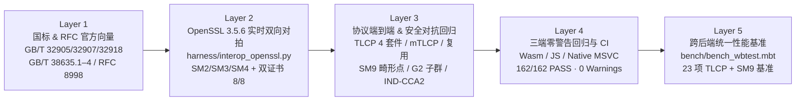

# MoonTLCP 工程验证日志与真实抓虫实录

> 对应 2026 MoonBit 黑客松评分维度 **04（开发与验证能力）**：记录本统一国密安全栈（**TLCP 1.1 PKI + SM9 BN256 IBC，共享 SM3/SM4/CT 核心**）的五层闭环验证体系、全量 162 项三端实测结果、全部可复现命令，以及研发与整合过程中真实捕获并修复的典型工程案例。

---

## 1. 五层验证闭环体系

本项目坚持“国标官方向量 + 跨语言实时对拍 + 协议/算法对抗安全测试 + 三端零警告回归 + 跨后端基准”五层验证：



### 1.1 各层验证覆盖明细

| 验证层级 | 验证目标与测试位置 | 关键覆盖内容 |
| :--- | :--- | :--- |
| **Layer 1：国标与 IETF 官方向量** | `crypto/{sm3,sm4,sm2}/*_test.mbt`、`x509/der/der_test.mbt`、`sm9/{hash,field,ec,pairing,kgc,sign,keyex,enc}/*_test.mbt`、`sm9/sm9_test.mbt` | GB/T 32905 SM3；GB/T 32907 SM4 单轮、**1,000,000 次迭代**及 GB/T 38635.4 A.3 SM4-ECB-PKCS#7 向量；RFC 8998 A.1 SM4-GCM；GB/T 32918.2/3/4 SM2；**GB/T 38635.1–4 SM9 全套附录 A（`H1`/`H2`/`KDF`/`MAC`、`e(P2,P1)` 384B、KGC 主/用户私钥、Part 2 签名、Part 3 密钥交换、Part 4 A.1 KEM / A.2 KDF-XOR / A.3 SM4-ECB-PKCS#7）逐字节对齐** |
| **Layer 2：OpenSSL 3.5.6 实时双向对拍** | `harness/interop_openssl.py` | **正向（OpenSSL → MoonTLCP，2/2 PASS）**：实时生成 SM2 CA + 签名/加密双证书与 SM3/SM4/SM2 向量，由 MoonTLCP 在 Wasm/JS 双端解析验签通过；**反向（MoonTLCP → OpenSSL，6/6 PASS）**：SM3/SM4-CBC/SM4-CTR/SM2 签验与解密 + MoonTLCP 签发的三张 X.509 v3 DER 证书经 OpenSSL 规范重编码逐字节一致并验签通过 |
| **Layer 3：协议端到端与对抗安全测试** | `record/`、`handshake/`、`x509/`、`state/state_test.mbt`、`state/adversarial_test.mbt`、`sm9/*_test.mbt` | **TLCP 端到端与 26+ 对抗**：4 大套件、mTLCP、Session ID 复用、>40KB 分片、1-byte trickle、CBC/GCM 篡改、版本降级 `0x0303`/`0x0100`、双证互换、CA 冒充叶子、握手帧 DoS、重放与 Fail-Closed；**SM9 端到端与对抗**：off-curve / `>=p` / 无穷远点 / 错误 `0x04` 前缀 / wrong-twist / **非素数阶 G2 cofactor 点拦截**、伪造签名与确认标签、97B IND-CCA2 密文探针统一报错、`entropy < 32B` 与 `klen > 16 MiB` 强制拒绝 |
| **Layer 4：三端零警告回归与 CI 门禁** | `.github/workflows/ci.yml`（Linux + Windows MSVC） | 强制执行 `moon fmt --check`、`moon info` `.mbti` 契约校验、`moon check -d`，以及 `wasm` / `js` / `native` 三端全量 **162 项测试** `moon test -d`（0 警告、0 失败） |
| **Layer 5：跨后端统一性能基准** | `bench/bench_wbtest.mbt` | 23 项 `@bench.T` 基准统一覆盖 SM3、SM4-CBC/GCM、SM2、X.509、RecordLayer（14 项）以及 SM9 BN256 配对、G1/G2 标量乘、签验、密钥交换、KEM 与 PKE（9 项） |

---

## 2. 真实抓虫与架构整合实录

以下 8 个案例均为本项目研发、跨语言对拍、对抗审计与统一合并过程中真实发生并完成回归固化的工程记录：

### 案例 1：RFC 8998 Appendix A.1 SM4-GCM 向量手工录入偏差（OpenSSL 3.5.6 实时比对定位）

- **问题现象**：编写 `crypto/sm4/sm4_test.mbt` 中 RFC 8998 A.1 SM4-GCM 向量时，输出密文部分字节与手工转录串存在差异。
- **根因定位与修复**：通过本机 **OpenSSL 3.5.6** 实测同一组 Key/IV/AAD/Plaintext，证实 MoonBit 输出密文与 Tag 与 OpenSSL **逐字节 100% 一致**，并固化到 `harness/interop_openssl.py` 自动化跨语言对拍。

### 案例 2：GM/T 0024 `ECC_SM4_*` 静态套件 `ServerKeyExchange` 线格式纠正

- **根因与修复**：对照 GB/T 38636-2020 §6.4.5.4 明确静态 `ECC_SM4_*`（`0xE013`/`0xE053`）仍须下发 `ServerKeyExchange` 对 `client_random || server_random || uint24(len(enc_cert)) || enc_cert` 进行 SM2-with-SM3 签名以绑定加密证书；在 `handshake/` 与 `state/` 强制实现并补齐伪造签名对抗用例。

### 案例 3：SM2 `C1C3C2` 无 `0x04` 前缀密文解码边界歧义

- **根因与修复**：在 `crypto/sm2/sm2.mbt` `decrypt_c1c3c2` 中结合 `PublicKey::from_bytes` 曲线点合法性校验进行安全回退，消除无前缀密文 $x_1$ 首字节恰好为 `0x04` 时的 1/256 误判风险。

### 案例 4：Strict DER 对 X.509 `BasicConstraints` 默认值与 `KeyUsage` NamedBitList 规范对齐

- **根因与修复**：严格省略 `BasicConstraints` 的 `cA=FALSE` DEFAULT 编码，剥离 `KeyUsage` `BIT STRING` 尾随零比特，并在 `parse_sig_algorithm` 兼容省略/显式 `NULL` 参数，通过 OpenSSL 3.5.6 规范 DER 重编码逐字节比对。

### 案例 5：OpenSSL 3.5.6 SM2 X.509 `distid` 透传差异（双向对拍实测定位）

- **根因与修复**：OpenSSL 3.5.6 `openssl verify` 未将 `-vfyopt distid:1234567812345678` 透传至 `ASN1_item_verify_ctx`；在 `harness/interop_openssl.py` 升级为 `openssl x509` 规范 DER 重编码比对 + `asn1parse` 提取 `tbsCertificate`/签名 + `pkeyutl -verify -rawin -digest sm3 -pkeyopt distid:1234567812345678` 密码学验签，达成 8/8 双向 PASS。

### 案例 6：MoonBit `v0.10.22` 同名包 `bench` 黑盒测试工具链边界

- **根因与修复**：`bench/` 下黑盒测试包别名 `@bench` 与标准库 `@bench.T` 冲突；将全部 23 项统一基准收敛至 `bench/bench_wbtest.mbt`，在 Wasm / Native MSVC 稳定无警告通过。

### 案例 7：全仓对抗式安全审核与协议纵深加固

- **修复与回归**：补齐 `MAX_HANDSHAKE_MSG_LEN = 65536` 帧上限防 DoS、RFC 5288 严格 64-bit `seq_num` GCM 显式 Nonce、mTLCP 会话复用隔离与 `ResumedSession` 长度校验、`Finished` 后空 `hs_buf` 断言、`CloseNotify` 后拒收应用数据，以及禁止 `is_ca == true` 证书冒充终端双证。

### 案例 8：TLCP 1.1 + SM9 共享密码核心零重复整合（Merge A）

- **架构挑战**：独立开发的 `moonsm9` 自带 588 行 SM3（`moonsm9/sm3/sm3.mbt`）与 304 行 SM4（`moonsm9/sm4/sm4.mbt`），若直接并入会导致同仓库并存两套 SM3 压缩核与两套 SM4 S-box/轮密钥扩展，且 `moonsm9` 中 `Sm3::update` 接受 `BytesView`、返回 `Option` 的 SM4-ECB-PKCS#7 接口与 `moontlcp/crypto/{sm3,sm4}` 存在签名差异。
- **工程解法**：
  1. 在共享 `crypto/sm3` 严格增量补充 `Sm3::update_byte` 与 `Sm3::reset`，在共享 `crypto/sm4` 复用 `encrypt_block_inplace`/`decrypt_block_inplace` 与 `@ct` 新增恒定时间 PKCS#7 `Sm4Key::ecb_encrypt_pkcs7`/`ecb_decrypt_pkcs7`（原有 `.mbti` 导出 100% 向后兼容）；
  2. 将 `sm9/hash` 收敛为薄适配层（仅保留 GB/T 38635.1 `H1`/`H2`/`KDF`/`MAC`/`Hv` 及 `BytesView` 包装），100% 委托 `crypto/sm3` 与 `crypto/ct`；
  3. `sm9/enc` 与 `sm9` 门面直接依赖 `CoolrfulDARkness/moontlcp/crypto/sm4` 调用共享 SM4 核，**彻底消除全部重复 SM3 压缩与 SM4 S-box 代码（静态扫描 0 处残留）**；
  4. 合并后统一验证门禁一次性通过：`moon check -d` 0 警告，`wasm`/`js`/`native` 三端 **162/162 PASS**，CLI 6 阶段全绿，OpenSSL 3.5.6 双向 **8/8 PASS**，23 项统一基准全部通过。

---

## 3. 可复现验证命令清单

### Linux / macOS

```bash
# 1. 格式与 .mbti 接口契约检查
moon fmt --check
moon info && git diff --exit-code -- '*.mbti'

# 2. 全库零警告类型检查与三端全量测试 (162/162 PASS)
moon check -d
moon test --target wasm -d
moon test --target js -d
moon test --target native -d

# 3. 6 阶段端到端实景演示 (TLCP 1.1 + SM9)
moon run --target wasm cmd/main

# 4. 跨语言 OpenSSL 3.5.6 双向对拍 (8/8 PASS)
python3 harness/interop_openssl.py

# 5. 23 项跨后端统一性能基准
moon bench --target wasm bench
moon bench --target native bench
```

### Windows (PowerShell + MSVC Build Tools)

```powershell
$env:PATH = "$env:USERPROFILE\.moon\bin;$env:PATH"

# 1. 格式与接口检查
moon fmt --check
moon info; git diff --exit-code -- '*.mbti'

# 2. Wasm / JS 零警告全量回归 (162/162 PASS)
moon check -d
moon test --target wasm -d
moon test --target js -d

# 3. Native (MSVC) 零警告全量回归 (162/162 PASS)
cmd /c '"C:\Program Files (x86)\Microsoft Visual Studio\2022\BuildTools\VC\Auxiliary\Build\vcvars64.bat" >nul && moon test --target native -d'

# 4. 6 阶段 CLI 实景演示与 OpenSSL 3.5.6 双向对拍 (8/8 PASS)
moon run --target wasm cmd/main
python harness/interop_openssl.py

# 5. 23 项跨后端统一性能基准
moon bench --target wasm bench
cmd /c '"C:\Program Files (x86)\Microsoft Visual Studio\2022\BuildTools\VC\Auxiliary\Build\vcvars64.bat" >nul && moon bench --target native bench'
```
