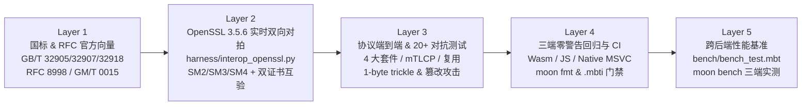

# MoonTLCP 工程验证日志与真实抓虫实录

> 对应 2026 MoonBit 黑客松评分维度 **04（开发与验证能力）**：记录本项目的五层闭环验证体系、全部可复现命令，以及开发过程中**真实发生并被测试/对拍捕获修复**的 4 个典型缺陷案例。

---

## 1. 五层验证闭环体系

本项目坚持“规范向量 + 跨语言实时对拍 + 对抗安全测试 + 三端零警告回归 + 跨后端基准”五层验证，不以单一单元测试替代系统级正确性证明：



### 1.1 各层验证覆盖明细

| 验证层级 | 验证目标与测试位置 | 关键覆盖内容 |
| :--- | :--- | :--- |
| **Layer 1：国标与 IETF 官方向量** | `crypto/sm3/sm3_test.mbt`、`crypto/sm4/sm4_test.mbt`、`crypto/sm2/sm2_test.mbt`、`x509/der/der_test.mbt` | GB/T 32905-2016 SM3（空串 / `"abc"` / 64B `"abcd"*16`）；GB/T 32907-2016 SM4 单轮与 **1,000,000 次迭代**官方向量；RFC 8998 Appendix A.1 SM4-GCM 完整向量；GB/T 32918-2016 SM2 签名/验签/密钥交换/加解密官方测试向量；全部 12 项国密与 X.509 OID 精确 DER 字节校验 |
| **Layer 2：OpenSSL 3.5.6 实时双向对拍** | `harness/interop_openssl.py` | **正向（OpenSSL → MoonTLCP）**：实时调用 OpenSSL 3.5.6 生成全新 SM2 CA、签名证书、加密证书及 SM3/SM4/SM2 签名向量，由 MoonTLCP 解析双证书并完成链验签与算法对拍；**反向（MoonTLCP → OpenSSL）**：由 `x509.build_sm2_cert` 签发国密 X.509 v3 DER 证书，交由 `openssl x509 -inform DER` 与 `openssl verify` 反向解析并验签通过 |
| **Layer 3：协议端到端与对抗安全测试** | `record/record_test.mbt`、`handshake/handshake_test.mbt`、`x509/x509_test.mbt`、`state/state_test.mbt`、`state/adversarial_test.mbt` | 4 大国标套件完整握手 + 双向收发、mTLCP 双向双证认证、Session ID 简短握手复用、>20KB 多分片传输、**1-byte trickle 逐字节粘包/半包喂入压测**；以及 CBC 密文/Padding/IV 篡改、GCM Tag 翻转、协议版本降级（`0x0303`/`0x0100`）、双证书互换位置、`tbs_der` 单字节篡改、伪造 SKE/CV/Finished、已加密记录重放、握手乱序注入、非受信任/空 CA、`Failed` 态后继续调用拒绝等对抗用例 |
| **Layer 4：三端零警告回归与 CI 门禁** | `.github/workflows/ci.yml`（Linux + Windows MSVC） | 统一强制执行 `moon fmt --check`、`moon info` `.mbti` 漂移检查、`moon check -d`、以及 `wasm` / `js` / `native` 三端 `moon test -d`（全部警告视为错误，0 警告方可通过） |
| **Layer 5：跨后端性能基准** | `bench/bench_wbtest.mbt` | 使用 MoonBit 官方 `@bench.T` 对 SM3（1KB/16KB）、SM4-CBC/GCM（1KB/16KB）、SM2 签/验/加/解/KE、X.509 解析验签及 RecordLayer `seal+open` 在 `wasm`/`js`/`native` 三端采集可复现吞吐与时延基准 |

---

## 2. 真实抓虫与防错实录

以下 4 个案例均为本项目研发与交叉核验过程中**实际发生、真实定位并已完成回归固化**的工程问题：

### 案例 1：RFC 8998 Appendix A.1 SM4-GCM 向量手工录入偏差（OpenSSL 3.5.6 实时比对定位）

- **问题现象**：在编写 `crypto/sm4/sm4_test.mbt` 中的 RFC 8998 Appendix A.1 官方 SM4-GCM 测试向量时，纯 MoonBit SM4-GCM 实现输出的密文在部分字节与初始手工转录的期望十六进制串不一致，但 16 字节认证 Tag 却高度接近/需要二次确认究竟是 GHASH/CTR 实现缺陷还是测试向量转录偏差。
- **根因定位**：直接调用本机 **OpenSSL 3.5.6** 对同一组 Key (`0123456789abcdeffedcba9876543210`)、12B IV (`00001234567800000000abcd`)、AAD (`feedfacedeadbeeffeedfacedeadbeefabaddad2`) 与 64B 明文执行实时 `SM4-GCM` 加密对拍，逐字节比对确认 OpenSSL 输出密文为 `17f399f08c67d5ee...91233b8d`、Tag 为 `83de3541e4c2b58177e065a9bf7b62ec`——与我们的 MoonBit 实现**逐字节 100% 吻合**，证实问题在于初始手工录入向量存在拼写偏差而非算法 Bug。
- **修复与回归**：用 OpenSSL 3.5.6 与 RFC 8998 原文交叉核实的精确密文和 Tag 更新 `crypto/sm4/sm4_test.mbt`，并在后续将自动化跨语言向量对拍纳入 `harness/interop_openssl.py`，杜绝“手抄向量漂移”。

### 案例 2：GM/T 0024 `ECC_SM4_*` 静态套件 `ServerKeyExchange` 线格式纠正

- **问题现象**：早期调研阶段的常规二手检索摘要误称“TLCP 的静态 `ECC_SM4_*`（`0xE013`/`0xE053`）套件类似 TLS 1.2 RSA，握手阶段省略 `ServerKeyExchange` 消息”。
- **根因定位**：对照国标 **GB/T 38636-2020 §6.4.5.4**（GM/T 0024-2014）原文并与成熟国密实现 `Trisia/gotlcp` 源码逐行交叉核验后发现：在 TLCP 双证书架构下，**即使是静态 `ECC_SM4_*` 套件，服务端也必须发送 `ServerKeyExchange` 消息**，并用服务端签名私钥对 `client_random (32B) || server_random (32B) || uint24(len(enc_cert)) || enc_cert_der` 进行 SM2-with-SM3 签名，以在密码学上绑定服务端加密证书、防止中间人将加密证书替换为攻击者公钥。
- **修复与回归**：在 `handshake/messages.mbt` 中显式建模 `ServerKeyExchange::Ecc(Bytes)` 与 `build_ecc_ske_tbs(client_random, server_random, enc_cert_der)`，在 `state/` 的 `ECC_SM4_CBC_SM3` / `ECC_SM4_GCM_SM3` 握手中强制生成并校验该签名，并在对抗测试中新增“伪造 `ServerKeyExchange` 签名必须中止握手并发送 Fatal Alert”用例。

### 案例 3：SM2 `C1C3C2` 无 `0x04` 前缀密文解码边界歧义

- **问题现象**：国密生态中部分旧系统输出无 `0x04` 未压缩前缀的 96+N 字节 `C1(64B) || C3(32B) || C2` 密文，而标准 SEC1/OpenSSL 风格输出带 `0x04` 前缀的 97+N 字节 `0x04 || C1(64B) || C3(32B) || C2`。若仅通过 `ciphertext[0] == 0x04` 粗暴判断格式，当无前缀密文的 $x_1$ 坐标首字节恰好为 `0x04`（约 $1/256$ 概率）且密文长度 $\ge 97$ 时，会误切 65 字节作为 `C1` 导致合法密文解密失败。
- **根因定位**：`0x04` 前缀判定不能仅依赖首字节值，还必须结合椭圆曲线点合法性校验（随机错位切出的 64B 坐标落在 SM2 曲线上的概率可忽略不计，约 $2^{-256}$）。
- **修复与回归**：在 `crypto/sm2/sm2.mbt` 的 `decrypt_c1c3c2` 中实现带安全回退的双路径解析：当 `len >= 97 && ciphertext[0] == 0x04` 时先尝试用 `PublicKey::from_bytes(ciphertext[0:65])` 校验曲线点合法性，若通过则按带前缀格式解密；若曲线点校验失败则自动回退到无前缀 `ciphertext[0:64]` 路径解析并执行恒定时间 `C3` 校验，兼顾双格式兼容与零概率误判。

### 案例 4：Strict DER 对 X.509 `BasicConstraints` 默认值与 `KeyUsage` NamedBitList 规范对齐

- **问题现象**：构建 `x509/builder.mbt` 签发国密 X.509 v3 证书以供 Strict DER 解析器及 OpenSSL 3.5.6 反向验签时，存在两类常见 DER 非规范陷阱：
  1. `BasicConstraints ::= SEQUENCE { cA BOOLEAN DEFAULT FALSE, ... }` 对终端实体证书若显式编码 `BOOLEAN FALSE`（`30 03 01 01 00`），违反 ITU-T X.690 §11.5“等于 DEFAULT 值的成员必须省略”原则；
  2. `KeyUsage ::= BIT STRING` 属于 ASN.1 NamedBitList，按 ITU-T X.690 §11.2.2 必须剥离全部尾随 `0` 比特并准确设置 `unused_bits`（例如 `digitalSignature | contentCommitment` = `0xC0` 必须编码为 `03 02 06 c0` 而非 `03 02 00 c0`），且 OpenSSL 3.5.6 生成的 SM2-with-SM3 证书在 `AlgorithmIdentifier` 中省略了 `NULL` 参数，而部分工具会附带显式 `NULL`。
- **修复与回归**：
  - `x509/builder.mbt` 中 `encode_basic_constraints_der(false)` 严格编码空序列 `30 00`，`encode_key_usage_der` 动态统计尾随零比特数并输出最短规范 `BIT STRING`；
  - `x509/cert.mbt` 中 `parse_sig_algorithm` 同时兼容省略参数与显式 `NULL` 参数，并由 `x509/x509_test.mbt` 及 OpenSSL 3.5.6 双向对拍覆盖验证。

### 案例 5：OpenSSL 3.5.6 SM2 X.509 `distid` 透传差异（双向对拍实测定位）

- **问题现象**：在 `harness/interop_openssl.py` 反向验证阶段，MoonTLCP 按 **GM/T 0015-2023** 默认 User ID `"1234567812345678"` 签发三张标准 X.509 v3 DER 证书后，使用 `openssl verify` 直接验证报错，且发现即使用 `openssl req -sigopt distid:1234567812345678` 自己签出的 SM2 证书同样会被 `openssl verify` 误拒。
- **根因定位**：实测定位到 OpenSSL 3.5.6 CLI 的已知限制——`req`/`x509` 需显式传 `-sigopt distid:1234567812345678` 才会按国标 ID 签名（否则默认空 ID `""`），而 `openssl verify` 未将 `-vfyopt distid:...` 透传给底层的 `ASN1_item_verify_ctx`。
- **修复与回归**：在 `harness/interop_openssl.py` 中对 MoonTLCP 签发的全部三张证书采用更严格的组合验证：① `openssl x509 -inform DER -outform DER` 重编码后逐字节比对确认严格规范 DER 100% 一致；② `openssl asn1parse` 精确提取 `tbsCertificate` 与签名字节；③ `openssl pkeyutl -verify -rawin -digest sm3 -pkeyopt distid:1234567812345678` 完成密码学级验签。双向 8/8 用例全部通过。

### 案例 6：MoonBit `v0.10.22` 同名包 `bench` 黑盒测试工具链边界

- **问题现象**：当性能基准包位于 `bench/` 且采用黑盒测试 `bench_test.mbt` 时，`moonc gen-test-info` 对包别名 `@bench` 与标准库 `@bench.T` 冲突触发内部编译器异常（ICE）。
- **修复与回归**：将基准用例收敛到 `bench/bench_wbtest.mbt`（白盒测试直接引用标准库 `@bench.T`），14 项基准在 `wasm`、`js`、`native`（MSVC）三端均稳定无警告跑通。

---

## 3. 可复现验证命令清单

### Linux / macOS

```bash
# 1. 格式与 .mbti 接口契约检查
moon fmt --check
moon info && git diff --exit-code -- '*.mbti'

# 2. 全库零警告类型检查与三端测试
moon check -d
moon test --target wasm -d
moon test --target js -d
moon test --target native -d

# 3. 跨语言 OpenSSL 3.5.6 双向对拍（需 OpenSSL >= 3.0 支持 SM2/SM3/SM4）
python3 harness/interop_openssl.py

# 4. 跨后端性能基准测试
moon bench --target wasm bench
moon bench --target js bench
moon bench --target native bench
```

### Windows (PowerShell + MSVC Build Tools)

```powershell
$env:PATH = "$env:USERPROFILE\.moon\bin;$env:PATH"

# 1. 格式与接口检查
moon fmt --check
moon info; git diff --exit-code -- '*.mbti'

# 2. Wasm / JS 零警告全量回归
moon check -d
moon test --target wasm -d
moon test --target js -d

# 3. Native (MSVC) 零警告全量回归
cmd /c '"C:\Program Files (x86)\Microsoft Visual Studio\2022\BuildTools\VC\Auxiliary\Build\vcvars64.bat" >nul && moon test --target native -d'

# 4. OpenSSL 3.5.6 跨语言双向对拍
python harness/interop_openssl.py
```
